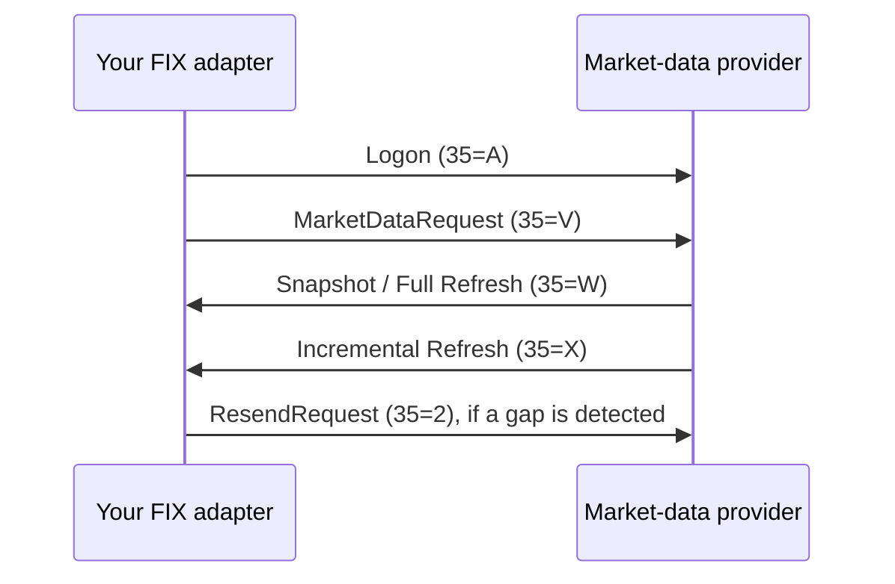
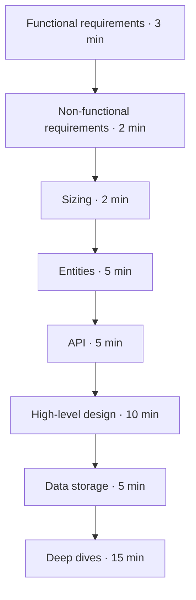

# Market indexes

<aside class="lab-prompt" aria-labelledby="market-index-design-prompt">
  <span class="lab-prompt-icon" aria-hidden="true">💡</span>
  <h2 id="market-index-design-prompt">Design a transactional market-index system</h2>
  <p>An index provider calculates 1,000 market indexes from live stock prices supplied by several external market-data providers over FIX. Clients subscribe to index updates and query the latest published value.</p>
  <p>Design a system that recalculates affected indexes as prices arrive, preserves correct results through retries and crashes, and can explain which inputs produced a published value. Index composition and divisors can change at a scheduled effective time.</p>
</aside>

For this exercise, <strong>transactional</strong> means that each committed index version, its calculation state, and its accepted input position agree after recovery. A duplicate input must not apply the same change twice, and a published version must remain recoverable. Define your transaction and publication boundaries explicitly; a single atomic transaction across all 1,000 indexes is not required.

Use price-weighted and capitalization-weighted indexes. Treat methodology as supplied business rules, not something you must invent. If you need a refresher, explore the [interactive market-index guide]({{ '/domain/market-indexes/' | relative_url }}) before starting.

<nav class="stage-dot-navigation" aria-label="Page sections" data-stage-navigation>
  <a href="#market-index-design-prompt" data-stage-link aria-label="Problem: Design a transactional market-index system" aria-current="step"><span class="stage-dot-tooltip">Transactional market indexes</span></a>
  <a href="#fix-in-one-minute" data-stage-link aria-label="FIX in one minute"><span class="stage-dot-tooltip">FIX in one minute</span></a>
  <a href="#interview-framework" data-stage-link aria-label="Interview framework"><span class="stage-dot-tooltip">Interview framework</span></a>
  <a href="#stage-1-functional-requirements-3-minutes" data-stage-link aria-label="Stage 1: Functional requirements"><span class="stage-dot-tooltip">Functional requirements</span></a>
  <a href="#stage-2-non-functional-requirements-2-minutes" data-stage-link aria-label="Stage 2: Non-functional requirements"><span class="stage-dot-tooltip">Non-functional requirements</span></a>
  <a href="#stage-3-sizing-2-minutes" data-stage-link aria-label="Stage 3: Sizing"><span class="stage-dot-tooltip">Sizing</span></a>
  <a href="#stages-48-design-on-the-board-40-minutes" data-stage-link aria-label="Stages 4–8: Design on the board"><span class="stage-dot-tooltip">Stages 4–8: Design on the board</span></a>
  <a href="#stage-4-entities-5-minutes" data-stage-link aria-label="Stage 4: Entities"><span class="stage-dot-tooltip">Entities</span></a>
  <a href="#stage-5-api-5-minutes" data-stage-link aria-label="Stage 5: API"><span class="stage-dot-tooltip">API</span></a>
  <a href="#stage-6-high-level-design-10-minutes" data-stage-link aria-label="Stage 6: High-level design"><span class="stage-dot-tooltip">High-level design</span></a>
  <a href="#stage-7-data-storage-5-minutes" data-stage-link aria-label="Stage 7: Data storage"><span class="stage-dot-tooltip">Data storage</span></a>
  <a href="#stage-8-deep-dives-15-minutes" data-stage-link aria-label="Stage 8: Deep dives"><span class="stage-dot-tooltip">Deep dives</span></a>
  <a href="#further-reading-after-the-interview" data-stage-link aria-label="Further reading after the interview"><span class="stage-dot-tooltip">Further reading</span></a>
</nav>

## FIX in one minute

FIX (Financial Information eXchange) standardizes messages between financial systems. For this lab, assume classic FIX sessions over TCP with tag-value messages. The session layer handles logon, heartbeats, sequencing and recovery; application messages carry subscriptions and market data.



The diagram illustrates a possible subscription flow, not every provider's contract. `35` identifies the message type; `34` (`MsgSeqNum`) orders messages within a session direction—not globally across providers or instruments. Retransmissions can carry `43=Y` (`PossDupFlag`). One message can contain several market-data entries, so a message sequence number alone is not an entry identifier.

Agree on the provider's recovery policy: some data can be retransmitted; some is gap-filled and requires a fresh snapshot. Session recovery does not prove that your database or index consumer committed the data. A heartbeat is not an acknowledgement of a business transaction. See the [FIX session standard](https://fixtrading.org/standards/fixsession/) and [market-data overview](https://fixtrading.org/guidelines/data-transparency/).

## Interview framework

<div class="framework-diagram" markdown="1">



</div>

Use the same delivery framework as the [Inventory Reservations lab]({{ '/labs/design/inventory-reservations/' | relative_url }}), inspired by Hello Interview's [Delivery Framework](https://www.hellointerview.com/learn/system-design/in-a-hurry/delivery). Capture stages 1–3 below, then draw stages 4–8 on the board.

## Stage 1: Functional requirements (3 minutes)

Pick 3–5 outcomes. Clarify what constitutes an input price, when an index is recalculated, what subscribers receive, and how operators schedule a composition change. Decide which provider is authoritative for an instrument and what happens when it is unavailable. Keep trade execution and portfolio management out of scope.

<div class="lab-workspace-heading">
  <label class="lab-workspace-label" for="functional-requirements">Your functional requirements</label>
  <button class="lab-copy-button" type="button" data-copy-lab-note data-copy-target="functional-requirements">Copy</button>
</div>
<textarea class="lab-workspace" id="functional-requirements" data-lab-stage-title="Functional requirements" rows="8" placeholder="Write 3–5 focused requirements and your clarifying questions…" spellcheck="true"></textarea>

<details markdown="1">
<summary>Show a format example from another system</summary>

For a parcel-tracking system:

- A carrier can submit a tracking event.
- A customer can query a parcel's latest status.
- A customer can subscribe to status changes.

These describe outcomes, not technologies or components.

</details>

[Next: Non-functional requirements →](#stage-2-non-functional-requirements-2-minutes)

## Stage 2: Non-functional requirements (2 minutes)

Set latency, durability and recovery targets. Distinguish receiving a tick from durably accepting it, and calculating a value from publishing it. What happens if an input is missing or stale? During a network partition, should an index pause, publish a flagged stale value, or follow another explicit policy? Define ordering per index without assuming a global order from timestamps.

<div class="lab-workspace-heading">
  <label class="lab-workspace-label" for="non-functional-requirements">Your non-functional requirements</label>
  <button class="lab-copy-button" type="button" data-copy-lab-note data-copy-target="non-functional-requirements">Copy</button>
</div>
<textarea class="lab-workspace" id="non-functional-requirements" data-lab-stage-title="Non-functional requirements" rows="8" placeholder="Define correctness, freshness, latency, durability, and recovery targets…" spellcheck="true"></textarea>

<details markdown="1">
<summary>Show a format example from another system</summary>

For parcel tracking, accepted events must survive a node failure, duplicate deliveries must not create duplicate notifications, and the latest-status query should have p95 latency below 300 ms. A short notification delay during recovery may be acceptable.

</details>

[← Previous: Functional](#stage-1-functional-requirements-3-minutes) · [Next: Sizing →](#stage-3-sizing-2-minutes)

## Stage 3: Sizing (2 minutes)

Start with 1,000 indexes. Estimate distinct instruments, constituents per index, incoming price updates, index fan-out, subscribers, and retained history. One stock can belong to many indexes: input messages, price entries, recalculations and outgoing deliveries are different rates.

If the interviewer gives no further numbers, use these <strong>exercise assumptions</strong>: 10,000 distinct instruments, 500 constituents per index on average, 20,000 price entries/s sustained and 100,000/s at peak. Assume the traffic is skewed toward popular instruments. Negotiate publication cadence, subscriber count and retention before estimating output bandwidth and storage. These are fictional workload inputs, not market statistics or a prescribed architecture.

<div class="lab-workspace-heading">
  <label class="lab-workspace-label" for="sizing">Your sizing notes</label>
  <button class="lab-copy-button" type="button" data-copy-lab-note data-copy-target="sizing">Copy</button>
</div>
<textarea class="lab-workspace" id="sizing" data-lab-stage-title="Sizing" rows="8" placeholder="Estimate fan-out, peak work, retention, egress, and the bottleneck each number implies…" spellcheck="true"></textarea>

<details markdown="1">
<summary>Show sizing examples from another system</summary>

For a telemetry service:

```text
10^4 devices × 10 events/s        = 10^5 events/s
10^5 events/s × 10^3 bytes/event = 10^8 bytes/s
```

Separate ingest throughput from downstream fan-out and storage overhead. Round numbers to find the design constraint rather than calculate a false precision.

</details>

[← Previous: Non-functional](#stage-2-non-functional-requirements-2-minutes) · [Next: Design on the board →](#stages-48-design-on-the-board-40-minutes)

## Stages 4–8: Design on the board (40 minutes)

<button class="lab-copy-summary-button" type="button" data-copy-lab-summary>Copy stages 1–3 for the board</button>

<div class="lab-design-flow" aria-label="Visual design stages">
  <section class="lab-design-step" id="stage-4-entities-5-minutes" data-stage-target="#stage-4-entities-5-minutes">
    <span>Stage 4 · 5 min</span>
    <strong>Entities</strong>
    <p>Identify instruments, source sessions, price entries, versioned index definitions and published values. Show identities, effective times and relationships.</p>
  </section>
  <span class="lab-design-arrow" aria-hidden="true">→</span>
  <section class="lab-design-step" id="stage-5-api-5-minutes" data-stage-target="#stage-5-api-5-minutes">
    <span>Stage 5 · 5 min</span>
    <strong>API</strong>
    <p>Define ingestion events, latest-value queries, subscriptions and scheduled definition changes. Include versions, freshness status and retry behavior.</p>
  </section>
  <span class="lab-design-arrow" aria-hidden="true">→</span>
  <section class="lab-design-step" id="stage-6-high-level-design-10-minutes" data-stage-target="#stage-6-high-level-design-10-minutes">
    <span>Stage 6 · 10 min</span>
    <strong>High-level design</strong>
    <p>Trace one FIX update through acceptance, affected-index calculation and delivery. Mark ownership, transaction boundaries and every acknowledgement.</p>
  </section>
  <span class="lab-design-arrow" aria-hidden="true">→</span>
  <section class="lab-design-step" id="stage-7-data-storage-5-minutes" data-stage-target="#stage-7-data-storage-5-minutes">
    <span>Stage 7 · 5 min</span>
    <strong>Data storage</strong>
    <p>Choose keys, indexes and retention. Explain how input positions, calculation state and publication records agree after a crash or replay.</p>
  </section>
  <span class="lab-design-arrow" aria-hidden="true">→</span>
  <section class="lab-design-step" id="stage-8-deep-dives-15-minutes" data-stage-target="#stage-8-deep-dives-15-minutes">
    <span>Stage 8 · 15 min</span>
    <strong>Deep dives</strong>
    <p>Explore session recovery, split-brain ownership, hot instruments, backpressure, rebalancing, deterministic replay and safe publication.</p>
  </section>
</div>

Paste your notes from stages 1–3 into the board. Follow the normal flow first, then select two failure cases to examine in detail:

- A FIX connection drops after receipt but before durable acceptance; a reconnect retransmits data or resets the session sequence series.
- A process crashes after committing a new index version but before delivering it to subscribers.
- A gateway loses its lease, yet continues reading the provider while a replacement starts; prevent stale-owner writes, not just duplicate connections.
- A popular instrument updates while a new constituent set and divisor become effective; do not mix reference-data versions.
- A provider cannot replay a missing interval. Distinguish restoring the latest snapshot from reconstructing every historical index value.

These are design probes, not a required technology stack. If embedding is restricted by your browser, [open Excalidraw in a new tab](https://excalidraw.com/).

<div class="lab-drawing-board" id="design-board">
  <iframe src="https://excalidraw.com/?embed=true&amp;theme=dark" title="Excalidraw market index system design board" loading="lazy" allow="clipboard-read; clipboard-write" referrerpolicy="strict-origin-when-cross-origin"></iframe>
</div>

[← Previous: Sizing](#stage-3-sizing-2-minutes) · [Next: Further reading →](#further-reading-after-the-interview)

## Further reading after the interview

- [FIX session layer](https://fixtrading.org/standards/fixsession/): sequence numbers, reconnects and recovery semantics.
- [FIX market-data overview](https://fixtrading.org/guidelines/data-transparency/): snapshots and incremental updates.
- [Index Mathematics Methodology](https://www.spglobal.com/spdji/en/methodology/article/index-mathematics-methodology/): weighting methods and divisor continuity.
- [Distributed locks and fencing tokens](https://martin.kleppmann.com/2016/02/08/how-to-do-distributed-locking.html): compare your stale-owner protection with the failure model discussed here.
