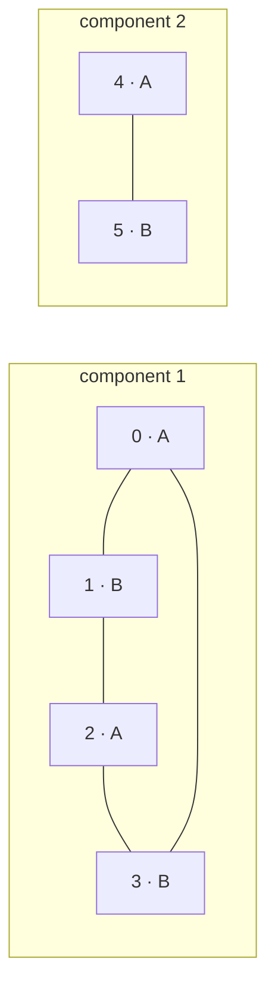

## Question

Given an undirected graph, decide in O(n+m) time whether its vertices can be split into two groups so every edge crosses between groups. For edges `0–1, 1–2, 2–3, 3–0, 4–5`, the split `{0,2,4} | {1,3,5}` works. Which idea meets the bound?

Vertices are `0..n-1`, with `1 ≤ n ≤ 200,000` and `0 ≤ m ≤ 300,000`. The graph may be disconnected; self-loops and parallel edges are allowed. An isolated vertex may be placed in either group.

The labels show one valid assignment for both connected components.

## Answers

a. Two-color every component with BFS/DFS, using opposite colors across edges; reject conflicts.
b. Use ordinary union-find; merge each edge's endpoints and reject any edge within one set.
c. Run topological sort after replacing each undirected edge with both directed orientations.
d. Start DFS only at vertex 0; accept if no edge returns directly to its parent.

<!-- correct-answer: a -->

Answer explanation

Two-color each component. Every traversed edge forces opposite colors; a same-color edge proves an odd cycle, while processing all components covers disconnected graphs.

