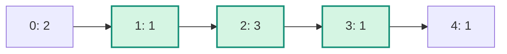

## Question

Given up to 200,000 non-negative costs and budget `K`, return in O(n) time the longest contiguous segment whose sum is at most `K`. For `[2,1,3,1,1]` and `K=5`, the answer is 3. Which algorithmic idea meets the requirement?

Each cost is between 0 and 1,000,000,000; `K` is between 0 and 10^18. Return 0 when no non-empty segment fits.

The highlighted window is indices 1 through 3: its sum is 5 and its length is 3.

## Answers

a. Start at every index and extend until the sum exceeds `K`, keeping the longest segment.
b. Sort the costs, then choose the longest prefix whose total does not exceed `K`.
c. Run Kadane's algorithm, resetting the current segment whenever its sum exceeds `K`.
d. Advance right once; while the sum exceeds `K`, advance left, then record the window.

<!-- correct-answer: d -->

Answer explanation

Non-negative values make the sum monotonic as either boundary moves. Shrink left only while over `K`; each index enters and leaves once, so the longest valid window is found in O(n).

