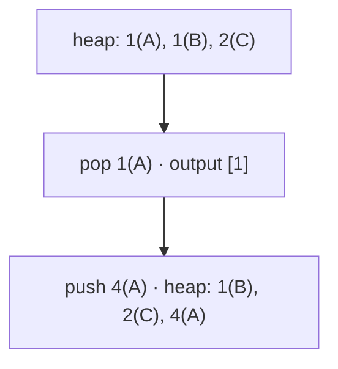

## Question

Given `k` sorted integer arrays containing `N` values in total, merge them into one sorted array in O(N log k) time and O(k) auxiliary space. For `[[1,4,4],[1,3],[2,6]]`, return `[1,1,2,3,4,4,6]`. Which idea meets both bounds?

Here `1 ≤ k ≤ 100,000` and `0 ≤ N ≤ 200,000`. Each array is sorted in nondecreasing order, values may repeat, and empty arrays are allowed. Preserve every duplicate; return an empty array when `N = 0`. Auxiliary space excludes the output.

Each heap entry stores a value, its source array, and its index in that array.

## Answers

a. Concatenate all arrays and comparison-sort all N values, then return the sorted result.
b. Insert every value into a skip list, then traverse its bottom level in sorted order.
c. Keep one current value per non-empty array in a min-heap; pop and replace until empty.
d. Scan all current array heads to choose each next value, advancing only the selected array.

<!-- correct-answer: c -->

Answer explanation

Only each array's current head can be next. A min-heap of at most k heads emits one value and advances one array per step, giving O(N log k) time and O(k) space.

