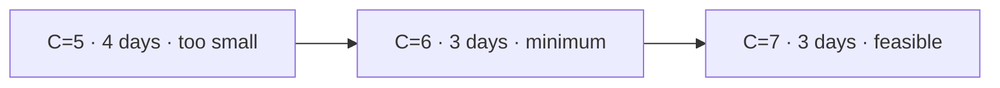

## Question

Given 1 to 200,000 positive package weights, split them in order into at most `D` non-empty consecutive days and return the minimum integer daily capacity in O(n log S), where `S` is their sum. For `[3,2,2,4,1,4]` and `D=3`, the answer is 6. Which idea meets the bound?

Each weight is at most 10^9, `1 ≤ D ≤ n`, every package must be shipped once, and packages cannot be reordered. Use 64-bit arithmetic.

At capacity 6, the days can be `[3,2]`, `[2,4]`, and `[1,4]`.

## Answers

a. Binary-search capacity from the heaviest package to the total, using a greedy day count.
b. Sort weights descending, then balance packages across `D` days with a priority queue.
c. Use a sliding window to maximize each day's load independently, then take its largest sum.
d. Use prefix DP by day, trying every earlier split position for each package prefix.

<!-- correct-answer: a -->

Answer explanation

Feasibility is monotone: if capacity C works, every larger one works. A greedy scan tests C in O(n), so binary search finds the minimum in O(n log S).

