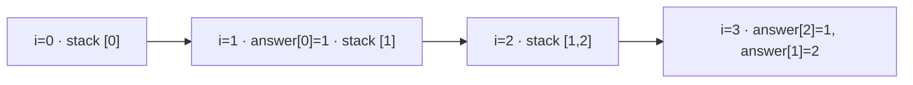

## Question

Given 1 to 200,000 integer temperatures, return for each index the distance to the nearest later strictly higher temperature, or 0 if none exists, in O(n) time. For `[73,74,71,75]`, return `[1,2,1,0]`. Which algorithmic idea meets the requirement?

Temperatures may repeat; an equal value is not warmer.

The stack contains indices whose answers have not yet been found.

## Answers

a. From every index, scan right until the first strictly higher temperature appears.
b. Keep unresolved indices in a non-increasing stack; pop them when a higher value arrives.
c. Sort indices by temperature, then compare adjacent indices in that sorted order.
d. Store suffix maximums and use each maximum's position as the next warmer index.

<!-- correct-answer: b -->

Answer explanation

A non-increasing stack holds unresolved indices. A higher value resolves each smaller top; every index is pushed and popped at most once, giving nearest answers in O(n).

