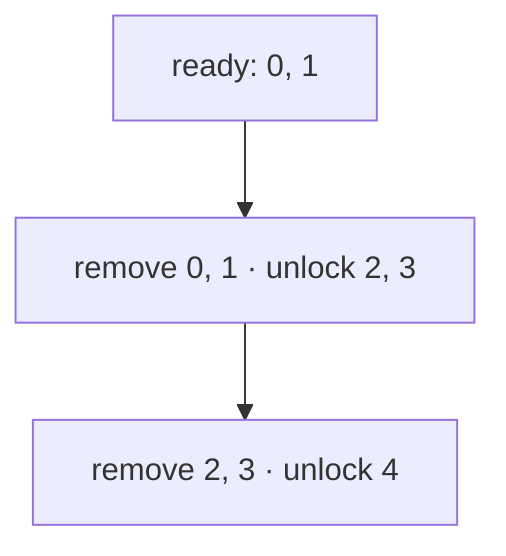

## Question

Given `n` tasks and edges `u→v` meaning `u` must finish before `v`, return any valid order or an empty array if impossible, in O(n+m) time. For `0→2, 1→2, 1→3, 2→4, 3→4`, one result is `[0,1,2,3,4]`. Which idea meets the bound?

Tasks are `0..n-1`, with `1 ≤ n ≤ 200,000` and `0 ≤ m ≤ 300,000`. The graph may be disconnected; self-loops and parallel edges are allowed. Count every edge occurrence. Any valid order is accepted.

A task becomes ready only after all of its incoming edges have been removed.

## Answers

a. Run BFS from vertex 0 and return vertices in their first-discovery order.
b. Sort vertices by outdegree, placing larger outdegrees before smaller ones.
c. Run Dijkstra from each initially ready vertex and concatenate the visit orders.
d. Queue every zero-indegree vertex; remove it, decrement successors, and require n removals.

<!-- correct-answer: d -->

Answer explanation

Kahn's algorithm queues tasks with no unmet prerequisites. Each vertex and edge is processed once; fewer than n removals proves that a directed cycle remains.

