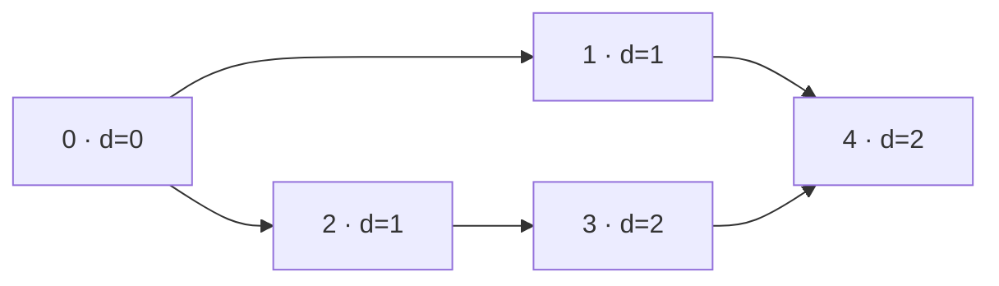

## Question

Given a directed unweighted graph with vertices `0..n-1`, find the minimum number of edges from `s` to `t`, or `-1` if unreachable, in O(n+m) time. For edges `0→1, 0→2, 1→4, 2→3, 3→4`, `s=0`, `t=4`, the answer is 2. Which idea meets the bound?

Here `1 ≤ n ≤ 200,000` and `0 ≤ m ≤ 300,000`; cycles, self-loops, and parallel edges are allowed. If `s == t`, return 0.

The labels show the distance assigned when each vertex is first discovered.

## Answers

a. Run DFS from `s` and return when `t` is first reached, using the recursion depth.
b. Relax every edge `n-1` times as in Bellman-Ford, then read the distance to `t`.
c. Run BFS from `s`, assigning each vertex the first distance at which it is enqueued.
d. Run Dijkstra with a priority queue, treating every directed edge as weight one.

<!-- correct-answer: c -->

Answer explanation

BFS visits vertices in nondecreasing edge distance. The first enqueue fixes the shortest distance; scanning every vertex and edge once meets O(n+m).

