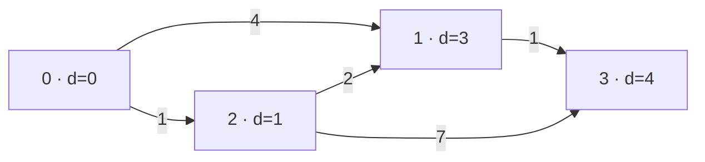

## Question

Given a directed graph with nonnegative edge weights, find the minimum total weight from `s` to `t`, or `-1` if unreachable, in O((n+m) log(n+m)) time. For `0→1(4), 0→2(1), 2→1(2), 1→3(1), 2→3(7)`, the answer is 4. Which idea meets the bound?

Vertices are `0..n-1`, with `1 ≤ n ≤ 200,000` and `0 ≤ m ≤ 300,000`. Each integer weight is `0..10^9`; cycles, self-loops, and parallel edges are allowed. Use `long` for distances. If `s == t`, return 0.

The labels show final distances; the cheapest route to 3 is `0→2→1→3`.

## Answers

a. Run BFS from `s` and return when `t` is first enqueued, ignoring edge weights.
b. Use Dijkstra with a min-heap; relax outgoing edges and discard stale heap entries.
c. Relax every edge `n-1` times with Bellman-Ford, then return `t`'s distance.
d. Sort edges by weight and union their endpoints until `s` and `t` become connected.

<!-- correct-answer: b -->

Answer explanation

Dijkstra's min-heap settles vertices by smallest known distance. Nonnegative weights make each settled distance final, and stale-entry skipping meets the required bound.

