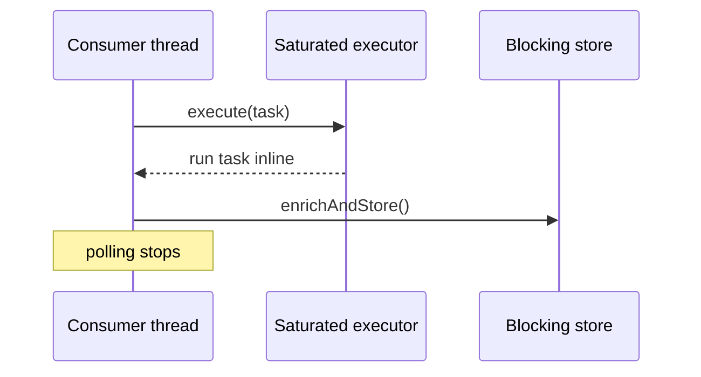

# CallerRunsPolicy can stall a Kafka poll loop

## Correct answer

c. The consumer runs rejected work inline; reject explicitly and pause or reduce intake.

## Detailed explanation

`ThreadPoolExecutor.execute` invokes its rejection handler when the pool is at its maximum and the work queue is full. `CallerRunsPolicy` does not merely notify the caller: unless the executor is shut down, it runs the rejected `Runnable` synchronously in the thread that called `execute`.

That behavior is intentional feedback. It slows producers when workers cannot keep up. It can be useful when the submitting thread is allowed to perform the work, but it is hazardous for event loops and protocol loops. Here the Kafka consumer thread may spend seconds in `enrichAndStore` instead of calling `poll`. Long enough pauses can exceed the poll interval and trigger a group rebalance.



Use an explicit rejection signal and make overload handling part of the consumer design. The poll thread can pause affected partitions, retain uncommitted work in a bounded pending structure, keep polling as required by the client protocol, and resume only when worker capacity returns. Reducing intake or scaling workers is also valid; silently moving blocking work onto the poll thread is not.

## Code example

```java
ExecutorService enrichmentPool = new ThreadPoolExecutor(
    8, 8, 0, TimeUnit.MILLISECONDS,
    new ArrayBlockingQueue<>(100),
    new ThreadPoolExecutor.AbortPolicy()
);

void onRecord(ConsumerRecord<String, Order> record) {
    try {
        enrichmentPool.execute(() -> enrichAndStore(record.value()));
    } catch (RejectedExecutionException saturated) {
        TopicPartition partition =
            new TopicPartition(record.topic(), record.partition());

        consumer.pause(Set.of(partition));
        pending.add(record); // bounded; do not commit this record yet
    }
}

// On the same consumer thread: poll regularly, then resume when capacity is available.
```

The pending structure also needs a hard bound and an overload policy. Otherwise the executor queue has only been replaced by another unbounded buffer.

## Why the other options are incorrect

- a. `execute` does not wait for bounded-queue space. A full queue triggers the configured rejection handler immediately.
- b. A pool never exceeds `maximumPoolSize`, and it does not transfer ownership of a thread. The rejection policy directly invokes `run` on the caller.
- d. `CallerRunsPolicy` does not log or drop solely because the pool is saturated. It runs the task inline unless the executor is shut down.
