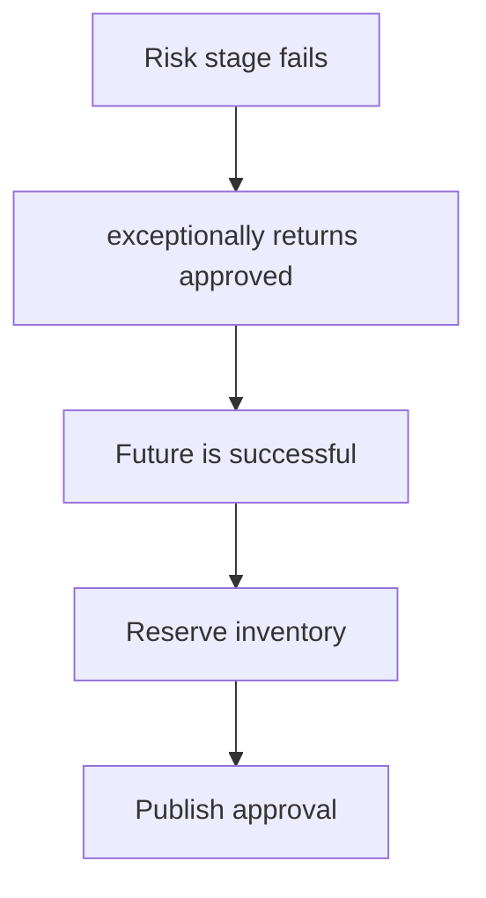

# CompletableFuture recovery that converts failure into approval

## Correct answer

b. exceptionally turns failure into approval, so later success stages still execute.

## Detailed explanation

`exceptionally` is a recovery operator. It runs only when the upstream stage completes exceptionally and returns a replacement value. If the callback itself returns normally, the stage produced by `exceptionally` is successfully completed with that value.

Here the fallback is an approved `Decision`. The following `thenApply` and `thenAccept` stages cannot distinguish it from a decision produced by the risk service, so they reserve inventory and publish an approval during an outage. The code may have been added to keep checkout responsive, but it silently changes a fail-closed business rule into fail-open behavior.

Use `whenComplete` when the goal is observation, such as logging or alerting, because it preserves the original outcome unless its callback throws. Alternatively, model an explicit degraded result and branch before any success-only side effect. Recovery belongs only where a fallback is valid for the business operation.



## Code example

```java
CompletionStage<Void> review(Order order) {
    return riskScore(order)
        .thenApply(this::decide)
        .whenComplete((decision, error) -> {
            if (error != null) {
                alerts.riskCheckFailed(order.id(), error);
            }
        })
        .thenApply(decision -> reserveInventory(order, decision))
        .thenAccept(this::publishApproved);
}
```

When `riskScore` fails, `whenComplete` records the incident but leaves the stage exceptional. Neither success-only stage executes, and the caller still observes the failure.

## Why the other options are incorrect

- a. `exceptionally` does not retry its upstream computation; it observes the terminal failure once and may replace it.
- c. `exceptionally` handles exceptional completion generally, including risk-service failures, not only cancellation.
- d. A normally returned fallback completes the new stage successfully; the failed state is not preserved downstream.
