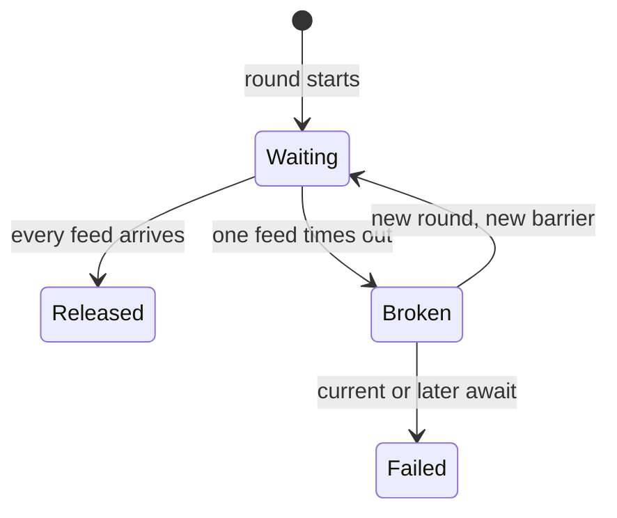

# CyclicBarrier timeout poisons later pricing rounds

## Correct answer

b. A timeout breaks the barrier; current and later waiters fail until it is safely replaced.

## Detailed explanation

A `CyclicBarrier` releases a generation only when every party arrives. It follows an all-or-none breakage model: if a waiting thread times out or is interrupted, that generation becomes broken. The timed caller gets `TimeoutException`, while other waiting callers get `BrokenBarrierException`.

The broken state remains visible to later calls. Reusing the same instance does not begin a healthy pricing round; `await()` fails immediately until the barrier is reset. Calling `reset()` also breaks any current waiters, so resetting a shared instance while old tasks can still arrive creates a generation race.

Model the synchronization object as part of one explicit round. After a timeout, cancel or let all tasks from that round finish, discard its partial data, and give the next round a new `CyclicBarrier`. A carefully coordinated `reset()` is possible, but replacement makes round ownership clearer.



## Code example

```java
final class PricingRound {
    private final CyclicBarrier ready = new CyclicBarrier(3);

    void accept(Quote quote) throws Exception {
        ready.await(100, TimeUnit.MILLISECONDS);
        aggregate(quote);
    }

    private void aggregate(Quote quote) {
        // Store and aggregate data owned by this round only.
    }
}

PricingRound current = new PricingRound();

try {
    receiveAllFeeds(current);
} catch (TimeoutException | BrokenBarrierException failedRound) {
    cancelRemainingFeedTasks();
    discardPartialRound();
    current = new PricingRound(); // a clean generation for the next round
}
```

The round data must be replaced with the barrier. Otherwise a late task from the failed round could contaminate the next calculation even if synchronization itself is healthy.

## Why the other options are incorrect

- a. A barrier does not expose consumable permits. A timeout breaks its current generation instead of decrementing permanent capacity.
- c. The failure is deliberately propagated: other waiters receive `BrokenBarrierException` rather than waiting forever in that generation.
- d. A timeout does not run the barrier action. The action runs only after the final party arrives successfully.
