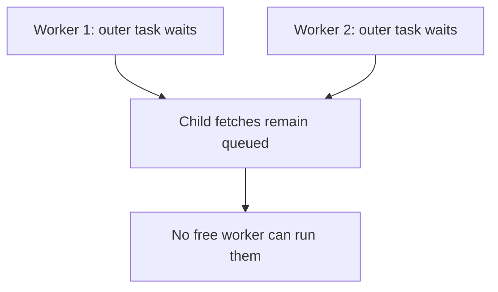

# Thread-starvation deadlock from nested executor submission

## Correct answer

d. Remove nesting and submit each blocking fetch as the only pool task for that request.

## Detailed explanation

Each request first schedules an outer task on `pool`. That worker then schedules an inner fetch on the same pool and blocks in `join()` until the inner future completes.

With one request and a two-thread pool, another worker can run the child, so tests may pass. With two concurrent requests, both workers can run outer tasks. Both then wait, while both child tasks sit in the queue. The pool cannot run the work required to release its own workers: a thread-starvation deadlock.



The clean fix is to remove the redundant outer stage. Submit the blocking fetch once to the bounded executor. If orchestration truly needs a separate stage, compose futures without blocking or use an explicitly separate executor whose capacity and failure behavior are designed for that boundary.

Merely enlarging the pool changes the load level at which starvation occurs. Queue capacity also cannot create a worker. Production code should keep dependency concurrency bounded and avoid blocking a pool worker on work queued to the same saturated pool.

## Code example

```java
CompletableFuture<Profile> enrich(String id) {
    return CompletableFuture.supplyAsync(
        () -> client.fetch(id),
        pool
    );
}
```

Now each admitted request consumes one worker only while performing the fetch; there is no child task that must run before its parent can release that worker.

## Why the other options are incorrect

- a. Queue fairness affects queued-task ordering, but the outer tasks are already running and holding every worker.
- b. Both `get()` and `join()` block the current worker; their exception and interruption APIs differ, not their pool behavior.
- c. A larger queue can hold more child tasks, but queued work still cannot start until a worker becomes free.
