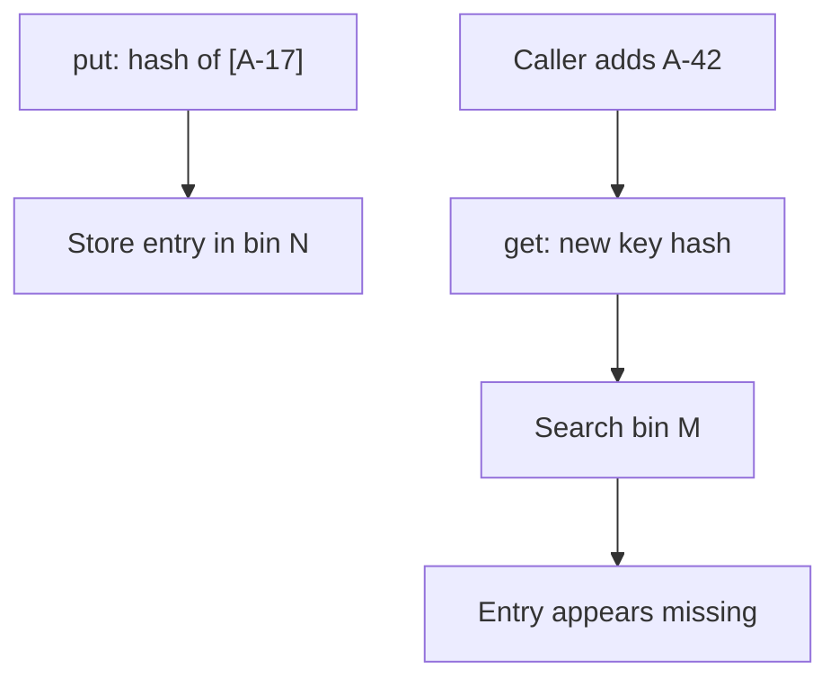

# Mutable record components used as map keys

## Correct answer

d. Copy the list in a compact constructor with `accountIds = List.copyOf(accountIds)`.

## Detailed explanation

A record prevents reassignment of its component fields, but it does not recursively freeze the objects referenced by those fields. `BatchKey.accountIds` is final, while the caller-owned `ArrayList` is still mutable.

The generated `equals` and `hashCode` methods use the list's contents. `ConcurrentHashMap.put` computes a hash and stores the entry in the corresponding bin. After `ids.add("A-42")`, the same `BatchKey` object has a different hash code. A later `get` can search a different bin and return `null`, even though the entry remains in the map. Concurrent mutation additionally races with equality and hashing; `ConcurrentHashMap` protects its own structure, not mutable key state.



The compact constructor runs before the compiler assigns the record field. Reassigning its parameter to `List.copyOf(accountIds)` makes the field reference an unmodifiable snapshot whose contents—and therefore hash code—cannot be changed through either the caller's list or the generated accessor. `List.copyOf` also rejects null lists and null elements, so that constraint should be part of the record's contract.

## Code example

```java
import java.math.BigDecimal;
import java.util.ArrayList;
import java.util.List;
import java.util.concurrent.ConcurrentHashMap;
import java.util.concurrent.ConcurrentMap;

record BatchKey(List<String> accountIds) {
    BatchKey {
        accountIds = List.copyOf(accountIds);
    }
}

List<String> callerIds = new ArrayList<>(List.of("A-17"));
BatchKey key = new BatchKey(callerIds);
ConcurrentMap<BatchKey, BigDecimal> totals = new ConcurrentHashMap<>();
totals.put(key, new BigDecimal("125.00"));

callerIds.add("A-42");
assert totals.get(key).compareTo(new BigDecimal("125.00")) == 0;
```

For large collections, copying has a construction cost. That is normally the correct tradeoff for a value object used as a hash key. If the intended identity is independent of the entire list, model that stable identity explicitly instead of relying on mutable contents.

## Why the other options are incorrect

- a. A final record component prevents reference reassignment; it does not prevent mutation of the referenced list or stabilize the generated hash code.
- b. Synchronization can prevent simultaneous access, but the key's hash is still different after a completed mutation, so a later lookup can search the wrong bin.
- c. A constant hash causes every key to collide and does not stabilize content-based equality; mutable keys can still change which other keys they equal.
